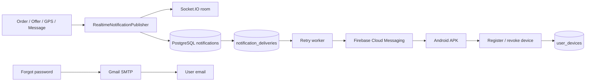

# MotoCare — email và thông báo chủ động

Cập nhật: 2026-10-12. Đây là luồng chạy thật, không phải mock. Khi chưa có cấu hình cục bộ, các adapter bên ngoài được tắt để CI và máy thành viên không giữ bí mật.

## Kiến trúc



- Socket.IO cập nhật ngay khi app đang mở; REST inbox là nguồn dữ liệu bền vững; FCM báo khi app ở nền hoặc đã đóng.
- FCM token không được trả lại qua API, không được log và bị vô hiệu khi logout. Token mới sau rotation được đăng ký lại.
- Delivery retry tối đa 5 lần với backoff. Token bị FCM xác nhận không còn hợp lệ sẽ bị disable.
- `offer.created`, `offer.expired`, thay đổi trạng thái đơn, tin nhắn mới và “thợ ở trong bán kính gần” đều tạo notification. Cảnh báo thợ gần chỉ tạo một lần mỗi đơn.
- Email quên mật khẩu dùng mã sáu số một lần, hết hạn sau 10 phút. SMTP sai cấu hình làm backend fail-fast khi khởi động thay vì âm thầm bỏ email.

## API cho Flutter

| Method | Path | Mục đích |
| --- | --- | --- |
| PUT | `/notifications/devices` | Đăng ký/cập nhật installation + FCM token sau đăng nhập |
| DELETE | `/notifications/devices/:installationId` | Tắt push khi logout |
| GET | `/notifications` | Inbox cursor, `limit`, `cursor`, `unreadOnly` |
| PATCH | `/notifications/:id/read` | Đánh dấu một thông báo đã đọc |
| PATCH | `/notifications/read-all` | Đánh dấu tất cả đã đọc |

Flutter đã có Firebase token source, token rotation, revoke khi logout và repository inbox. UI chỉ đọc controller/repository; không gọi Firebase hoặc Dio trực tiếp trong widget.

## Bật Gmail SMTP thật trên máy chạy backend

1. Dùng một Gmail riêng cho demo MotoCare, bật xác minh hai bước và tạo App Password. Google yêu cầu 2-Step Verification trước khi tạo App Password: <https://support.google.com/accounts/answer/185833>.
2. Điền vào `backend/.env` cục bộ, không gửi qua chat/ảnh và không commit:

```dotenv
EMAIL_ENABLED=true
SMTP_HOST=smtp.gmail.com
SMTP_PORT=587
SMTP_SECURE=false
SMTP_USER=your-demo-account@gmail.com
SMTP_PASSWORD=your-16-character-app-password
SMTP_FROM=MotoCare <your-demo-account@gmail.com>
SMTP_CONNECTION_TIMEOUT_MS=10000
SMTP_SOCKET_TIMEOUT_MS=30000
```

3. Kiểm tra đăng nhập SMTP mà không gửi mail: `npm run email:check`.
4. Muốn gửi một email kiểm thử thật, chỉ đặt recipient cho phiên PowerShell hiện tại:

```powershell
$env:SMTP_TEST_RECIPIENT='your-own-test-address@example.com'
npm run email:test
Remove-Item Env:SMTP_TEST_RECIPIENT
```

5. Khởi động lại backend và thử `POST /auth/password/forgot`. Không dùng mật khẩu Gmail thường; chỉ dùng App Password dành riêng cho MotoCare và thu hồi nó sau buổi nộp bài.

## Bật FCM thật cho APK Android

FCM hiện được Firebase liệt kê là sản phẩm không tính phí; có thể dùng Spark plan không cần phương thức thanh toán: <https://firebase.google.com/pricing>. Không bật Cloud Functions, Cloud Run, Storage hoặc Google Maps trong project này.

1. Tạo Firebase project ở Spark plan, thêm Android app có package `com.motocare.app`, bật Cloud Messaging API.
2. Backend: tạo service account tối thiểu cho FCM. Lưu JSON ngoài repository, ví dụ `D:\motocare-secrets\firebase-service-account.json`. Firebase khuyến nghị trỏ tới file bằng `GOOGLE_APPLICATION_CREDENTIALS`: <https://firebase.google.com/docs/admin/setup>.
3. Trong PowerShell chạy backend: `$env:GOOGLE_APPLICATION_CREDENTIALS='D:\motocare-secrets\firebase-service-account.json'`.
4. Điền `backend/.env`:

```dotenv
PUSH_NOTIFICATIONS_ENABLED=true
FIREBASE_PROJECT_ID=your-firebase-project-id
PROVIDER_NEARBY_RADIUS_METERS=300
```

5. Chạy `npm run push:check`. Lệnh chỉ xác minh Application Default Credentials, không gửi push. Khi push được bật, backend cũng xác minh credential lúc khởi động và fail-fast nếu không lấy được access token.
6. Sau khi đăng nhập trên APK, lấy FCM token của installation test trực tiếp trong DBeaver/local database (không qua API, chat hay ảnh chụp), rồi gửi push thật mà không ghi token vào file/log:

```powershell
$env:FCM_TEST_TOKEN='token-copied-locally-from-the-test-device'
npm run push:test
Remove-Item Env:FCM_TEST_TOKEN
```

Lệnh chỉ log kết quả chấp nhận, không in token.
7. Build APK với client config Firebase. Các giá trị này là cấu hình client được nhúng trong APK, không phải service-account/private key; vẫn không dán chúng vào chat:

```powershell
flutter build apk --release `
  --dart-define=API_BASE_URL=https://your-demo-api.example `
  --dart-define=PUSH_NOTIFICATIONS_ENABLED=true `
  --dart-define=FIREBASE_API_KEY=your-client-api-key `
  --dart-define=FIREBASE_APP_ID=your-android-app-id `
  --dart-define=FIREBASE_MESSAGING_SENDER_ID=your-sender-id `
  --dart-define=FIREBASE_PROJECT_ID=your-firebase-project-id
```

Android 13+ sẽ hỏi quyền thông báo sau khi người dùng đăng nhập. Nếu từ chối, realtime/inbox vẫn hoạt động nhưng hệ điều hành không hiện push. Android force-stop app thì phải mở lại app trước khi FCM nhận trở lại, theo tài liệu Firebase: <https://firebase.google.com/docs/cloud-messaging/flutter/receive-messages>.

## An toàn vận hành

- Tuyệt đối không commit service-account JSON, App Password, `.env`, JWT/HMAC secret hoặc signing keystore.
- Backend dùng Application Default Credentials; không nhúng private key vào TypeScript hoặc Dart.
- Không ghi FCM token vào log, crash report hoặc analytics.
- Khi mất điện thoại, logout không thành công hoặc nghi lộ credential: thu hồi App Password/service-account key và disable installation trong database.
- FCM không thay REST. Khi bấm notification, UI tải lại order/offer/message từ API trước khi hiển thị quyết định nghiệp vụ.
