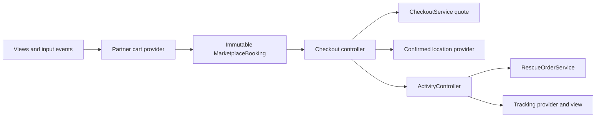

# Feature architecture and refactor boundaries

Moto Care uses a feature-first Flutter layout. The existing module guides in
this directory define product behavior; this document defines how those modules
share data and dependencies. Read it together with `AI_GUIDE.md`, `WORKFLOW.md`
and `DEPENDENCIES.md` before changing application code.

## Reading the existing design

The documentation separates three kinds of state:

- Confirmed session data: Profile, garage vehicles, incident location, Activity
  orders, partner applications and compensation reports.
- Route drafts: cart quantities, Checkout fields, identity-form selections and
  attachments, autocomplete results and the unconfirmed map pin.
- Presentation state: text/scroll controllers, sheet dimensions, focus,
  navigation, map rendering and animation interpolation.

`HOME.md`, `MARKETPLACE.md` and `LOCATION.md` describe the booking data flow.
`ACTIVITY.md` and `ORDER_TRACKING.md` define the shared order and tracking
boundaries. `PROFILE.md`, `VEHICLES_AND_RESCUE_STATIONS.md` and
`SERVICE_SCREENS.md` define account/device operations, discovery and support
features. The remaining guides govern dependencies, contributions, branches,
validation and releases. The more detailed current `LOCATION.md` describes real
Places/GPS support; older descriptions of sample location shortcuts do not
replace that configured integration.

Existing names and compatibility entry points remain: `TrangChu`,
`HoatDongScreen`, `IncidentLocationSearchScreen`, and `IncidentMapPickerScreen`.
Use `snake_case.dart` files, PascalCase model/service/controller/widget names,
and lowerCamelCase fields and providers. New state uses Riverpod `Notifier`
(the installed Riverpod 3 API), without a second state-management library.

## Module layout

| Directory | Responsibility |
| --- | --- |
| `models/` | Typed domain values and immutable state snapshots; no Widget dependencies. |
| `data/` | Explicit sample catalogs and initial data; no sample records in screens. |
| `services/` | Validation, pricing, order construction, device/API operations and simulation. |
| `providers/` | Dependency injection, state transitions, async request lifetime and derived data. |
| `screens/`, `widgets/` | Render provider/model values, forward events, navigate and manage Flutter presentation controllers. |
| `theme/` | Existing colors, text styles and surface styling. |

Small UI descriptors, icon mappings, display labels, layout constants and
animation controllers are presentation concerns. Service-option prices,
identity validation, GPS request revisions, order creation
and simulated checkpoint timers are application concerns and live outside
Widgets. `activity_actions.dart` and `rescue_station_actions.dart` are existing
presentation adapters for dialogs/navigation/feedback; the order service and
controllers do not depend on them.

The shared `CancelOrderDialog` owns its selected reason, text controller and
focus. `OrderCancellationReason` validates and trims the reason into an immutable
JSON payload; `ActivityController` preserves it on the cancelled order and
timestamped lifecycle event. `ActivityActions.cancel` coordinates dismissal,
feedback and navigation to Home after a successful transition. No cancellation
endpoint is assumed, and legacy orders without reasons remain readable.

Domain models may derive totals or other domain values. Some existing
presentation metadata (for example `HomeService` icons and colors) lives in a
model, separate from its rendering Widget. Provider files re-export relocated
public model types where existing callers need compatibility. Models do not
export sample catalogs.

## Booking and location

`CheckoutState` holds the address draft, note, payment preference, errors and
submission/GPS status. `CheckoutService` derives the current quote from the
booking, shop directory and location. The total is the service subtotal plus
travel fee. `CheckoutScreen` delegates its existing constructor and route to
`OrderSummaryScreen`; reusable summary cards live in the rescue widgets folder.
Its scoped `OrderSummaryTheme` uses white/black/red without changing the shared
palette. At submission the controller obtains a fresh quote, confirms the
location, checks the displayed travel fee and creates the shared order. `RescueOrderService` preserves the existing price/JSON fields and
uses an injectable clock for identifiers; `ActivityController` owns session
orders and enforces cancellation/rating/report transitions.
Orders snapshot requester contact information at creation and carry typed,
immutable lifecycle events with known timestamps. The
[rescue progress details](ORDER_DETAILS.md) provider derives four horizontal
steps and a timeline through `OrderDetailsService`; the UI never invents missing
transition times and keeps invoice and contact navigation on the same order ID.

`LocationSearchController` owns the 300 ms debounce, Places session token,
request cancellation/revisions, details, GPS and manual geocoding. It returns a
draft to the view for navigation. `IncidentMapController` owns selected
coordinates, reverse geocoding, camera coordination and final confirmation.
`IncidentCameraController` is a service contract implemented by the native map
adapter. Disposal cancels pending requests. Old responses cannot replace newer
queries, coordinates or typed addresses. Search and map drafts do not update
shared location until the established confirmation point; Checkout retains its
existing GPS-confirmation behavior.

## Chat, tracking and attachments

`ChatService` constructs messages, copies image bytes, supplies the demo reply
and delegates phone launch through the existing injectable launcher. Its clock
is injectable. `ChatMessagesController` owns immutable messages and cancels
pending reply timers when disposed. Sample conversations, support messages,
notifications and quick replies live in `chat/data/` behind providers.

The [conversation UI](CHAT.md) uses a fixed contact header, gray received bubbles,
black sent bubbles and external timestamps. The compact composer reveals the
existing quick replies through its “+” button; contact details and phone actions
retain the selected conversation and draft.

`OrderTrackingFeed` supplies immutable GPS/road-route observations through an
auto-disposed StreamProvider. `OrderTrackingController` retains the latest valid
observation, filters stale/other-order events and preserves it on connection
errors. A configured feed disables demonstration movement. Without a feed, the
controller owns the 1.5-second checkpoint timer and journey step; the view
supplies foreground/chat/reduced-motion/route visibility signals and retains
its Flutter interpolation controller. `OrderTrackingService` resolves map,
contact, status and ETA data into a snapshot consumed by presentation widgets.
Sample mechanic metadata is injectable separately. Movement does not change
the shared order status. See [ORDER_TRACKING.md](ORDER_TRACKING.md) for integration.
`trackingChatProvider` holds typed local messages while the parent tracking
route listens; closing the sheet retains them and leaving the route disposes
that conversation. It has no simulated replies.

`attachment_service.dart` helpers supply the gallery/camera boundary, 1600-pixel
capture settings, 5 MB limit and error/required-photo validation.
`AttachmentController` handles picking state and late/disposed results.
The [service rating screen](SERVICE_RATING.md) uses the same gallery boundary.
Its stateful view owns the unsubmitted star/tag/comment/photo draft;
`ServiceRatingService` validates and copies it into an immutable review, and
`ServiceRatingsController` coordinates the injectable submission boundary,
shared Activity stars and session review storage. Failed submission retains the
draft and does not commit review data.
`PhotoAttachmentField` renders the preview and forwards selected bytes. Partner
registration retains both identity photos in its route draft; the registration
service validates the required fields and constructs an immutable application.
No identity-photo upload endpoint or disk persistence is introduced.

## Supporting modules and integration

- Partner capabilities, directory filtering, cart quantities and booking
  construction are supplied through feature providers.
- FAQ, price groups, service-place samples and
  policy commitments have explicit injectable data boundaries.
- Completed-order spending summaries, Activity filtering and
  compensation eligibility are derived providers rather than Widget loops.
- Shared search normalization, location validation, auth/password validation and
  profile/HomeUser mapping are reused outside Widgets.

The app remains a session prototype where the feature guides say so. Refactoring
does not turn sample mechanic movement into GPS, sample chat into delivery,
wallet selection into charging, or registration/compensation records into server
submissions. Replace service/data providers with the approved Dio/backend
integration when those endpoints exist. Keep sensitive bytes and credentials out
of logging and persistence.

The refactor preserved feature theme files, route contracts, dependency versions
and native configuration. Revo Home now scopes its monochrome palette through
`RevoHomeTheme`; existing features use black primary actions and neutral accent tints
from `HomeColors`, including Chat's outgoing messages and send control. The
legacy `red` color aliases resolve to the shared black primary. Home station
metadata, search/filter state and sorting live in feature
data/models/providers/services, separate from the
two-column card widgets. The shared light navigation uses four floating tabs;
the Station map route selects map mode through `view=map`.

The [smart weather Home card](HOME.md) keeps forecast records in `data/`, typed
weather and quick actions in `models/`, forecast loading and shared selection in
Riverpod providers, and risk evaluation in `WeatherRescueService`. The injectable
`HomeWeatherService` currently supplies a labeled demo forecast; an HTTP adapter
can replace it independently of the view. `SmartWeatherRescueCard` owns only
Flutter focus/scroll controllers, and `HomeDiscoveryService` filters quick actions
against actual station capabilities. The header uses a blank account placeholder
and preserves shared location/account/notification routes. The standalone legacy
`HomeVideoHero` remains available with its playback lifecycle tests.

The [station detail feature](STATION_DETAILS.md) scopes its white/black/red
`StationDetailTheme` to profile and review pages. `StationModel` composes the
existing directory identity, Home metadata, injectable profile and marketplace
prices through `StationDetailsService`. Its providers own session favorites and
partner-ID-filtered confirmed reviews; the share service owns the native share
boundary. Booking and chat continue to use their existing feature routes.
`ServiceCatalogModel` joins each supported package with that station's published
procedure, materials and warranty metadata. `StationServicesCatalog` only opens
an information sheet; package selection remains in the partner booking feature.

## Welcome and typography

The [customer profile dashboard](PROFILE.md) lives at the requested
`customer/profile/profile_screen.dart` entry point, with the former profile route
import retained as a re-export. It renders shared profile values through a scoped
white/black/blue theme using the shared navigation accent. Device/account
operations and pending state live in
`profileActionsProvider`; profile dialogs and information sheets use presentation
adapters. No reference identity is stored as application data.

The startup redirect is `/welcome`, with `/login`, `/register` and
`/forgot-password` retaining their existing form behavior. Welcome uses the auth
feature's `AuthScaffold` and light `AuthTheme`, displaying only `Ảnh.png` and
a bottom “Tiếp” button that pushes `/login`. The three authentication forms use
`AuthScaffold` and `AuthTheme.light` with white backgrounds, gray inputs and black
primary buttons. Each screen retains its original safe-area, scroll and keyboard
layout, form state and routes.
All feature color schemes inherit neutral error and container colors.
Bundled Montserrat is the application
text font in all shared and feature themes, explicit button styles and custom
map labels. Its Regular, Medium, SemiBold, Bold, ExtraBold and italic files cover
Vietnamese letters and combining marks without the previous Noto Sans fallback.
The font assets and their SIL Open Font License are declared in `pubspec.yaml`.
Icon fonts retain their own font families.

Black-accent review captures: [incident location](screenshots/black-accent-location.png),
[marketplace](screenshots/black-accent-partners.png),
[Activity](screenshots/black-accent-activity.png),
[profile](screenshots/black-accent-profile.png),
[chat](screenshots/black-accent-chat.png) and
[tracking](screenshots/black-accent-tracking.png).

`RevoLogo` uses the canonical transparent `Logo_Revo.png` asset and crops its
padding only at render time. Native splash generation derives temporary PNGs
in `.dart_tool/revo_splash/` from that same source. See the root README for
regeneration instructions.

## Validation

The existing widget suite covers the route flows, totals, removed reward routes, photos,
draft cancellation, GPS/Places races, lifecycle pauses, retained session data
and 320 px layouts with large text and the keyboard. Independent controller
and service tests additionally exercise those boundaries without a Widget.

Controlled before/after captures compare Checkout, tracking, chat, identity
registration and the rescue request sheet at 390 × 844, with bundled
Roboto fonts, fixed sample records and reduced motion. These compare Flutter
rendering; they do not validate physical-device Google tiles or native dialogs.
Run the repository formatting check, `flutter analyze --no-pub`,
`flutter test --no-pub` and `flutter build apk --debug --no-pub` for changes to
these boundaries.

Refactor verification: the 231 existing tests and 8 new controller/service tests
passed. The six controlled before/after PNG captures were byte-for-byte identical.
